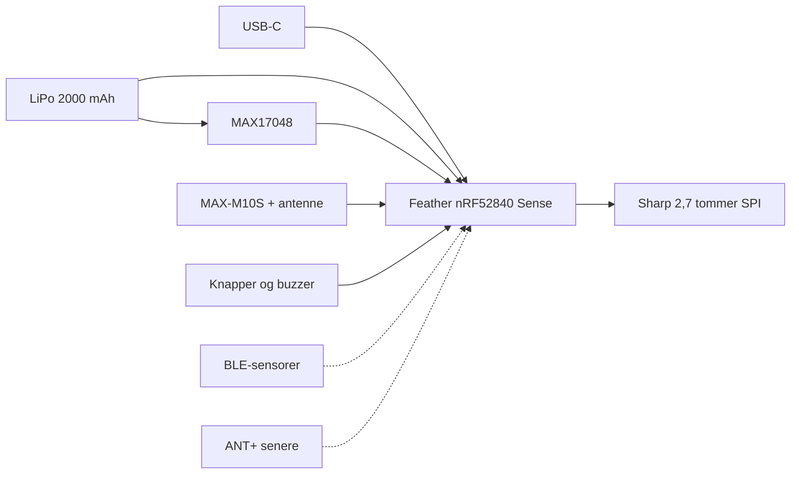

# openCycloComputer

En åben GPS-cykelcomputer til selvbyg. Målet er en enhed med lang batterilevetid, der kan sidde ude på styret: sol-læsbart display, GPS, pulsbælte og wattmåler, og en turfil bagefter. Projektet er offentliggjort under MIT-licens af Martin Bjærge Jensen ([@rastermanden](https://github.com/rastermanden)).

Første prototype bygges på færdige moduler, ikke et eget printkort. Kabinettet er et parametrisk første udkast, som skal tilpasses når delene er i hånden.

## Mål

- Vise fart, tid, distance, højde og puls/watt under kørslen, også i sol.
- Holde strøm nok til en lang dag eller et brevet på et 2000 mAh LiPo-batteri.
- Gemme turen som FIT (GPX kan komme ovenpå) og få den over på en telefon eller en computer.
- Sidde i et 3D-printet, tæt kabinet med standard Garmin quarter-turn-holder.
- Holde softwaren på Zephyr og nRF Connect SDK, så lavt strømforbrug og senere ANT+ er muligt.

Navigation og synkronisering til Strava eller Garmin Connect er bevidst senere. Det samme er et eget printkort.

## Funktioner

Med i den første prototype:

- Adafruit Feather nRF52840 Sense (BLE, LiPo-lader, 2 MB QSPI-flash, IMU og barometer)
- Sharp Memory LCD 2,7" 400×240
- u-blox MAX-M10S (GPS, Galileo, GLONASS, BeiDou)
- LiPo 3,7 V 2000 mAh og MAX17048 som brændstofmåler
- Knapper og en lille buzzer
- Turlog på den indbyggede flash

Senere:

- BLE-sensorer: puls, fart, kadence, watt. ANT+ først når BLE-vejen virker
- FIT/GPX ud af boksen, og en vej over på telefonen
- Navigation (pil eller brødkrumme) og synkronisering
- Tættere kabinet efter en rigtig felt-test, og på sigt et eget printkort

## Arkitektur

GPS-modulet er den store strømforbruger. Displayet er valgt fordi det kan opdateres hvert sekund uden at det koster batteriet. Feather Sense har allerede barometer og IMU, så de skal ikke købes ved siden af. SparkFun-breakoutet har SMA-stik, så der skal en separat GNSS-antenne med.

## Status

31. oktober 2026: repoet er oprettet, stykliste og strømbudget ligger i `docs/`, og der er et første FreeCAD-kabinet med Garmin-holder. Der er ikke bestilt dele, og der er ingen firmware endnu.

Køreplanen (milepæle M0 til M8 og de tilhørende opgaver) ligger i [docs/roadmap.md](docs/roadmap.md). Den kunne ikke oprettes som GitHub-issues med den adgang cloud-agenten har. Se toppen af den fil.

## Dokumentation

| Emne | Fil |
| --- | --- |
| Hardwarevalg | [docs/hardware.md](docs/hardware.md) |
| Stykliste med priser | [docs/bom.md](docs/bom.md) |
| Strømbudget | [docs/power-budget.md](docs/power-budget.md) |
| ANT+ og hvorfor BLE kommer først | [docs/ant-plus.md](docs/ant-plus.md) |
| Byggelog | [docs/buildlog.md](docs/buildlog.md) |
| Køreplan | [docs/roadmap.md](docs/roadmap.md) |
| Firmware-plan | [firmware/README.md](firmware/README.md) |
| Kabinet, FreeCAD og P1S | [enclosure/README.md](enclosure/README.md) |

## Mapper

- `firmware/` — Zephyr/nRF Connect SDK. Board-target er Feather nRF52840 Sense. Ingen applikation endnu.
- `hardware/` — plads til datablade, noter og senere et eget printkort.
- `enclosure/` — parametrisk FreeCAD-model, STEP og STL.
- `tools/` — script der kan oprette GitHub-labels, milepæle og issues ud fra `tools/issues.yaml`.
- `docs/` — den danske projektdokumentation.

## Licens

[MIT](LICENSE). Copyright 2026 Martin Bjærge Jensen.

Firmware og mekanik må bruges, ændres og sælges videre på MIT-vilkår. Det gælder ikke ANT+-stakken: den ejes af Garmin, og en kommerciel licens er et andet spor. Læs [docs/ant-plus.md](docs/ant-plus.md) før noget sælges.

## Bidrag

Fejl og forslag er velkomne som issues eller pull requests. Kabinettets mål er parametre i `enclosure/freecad/build_enclosure.py`. Ret dem der, eller læg en `overrides.csv` ved siden af scriptet, og byg filerne igen. Beskrivelsen står i [enclosure/README.md](enclosure/README.md).
