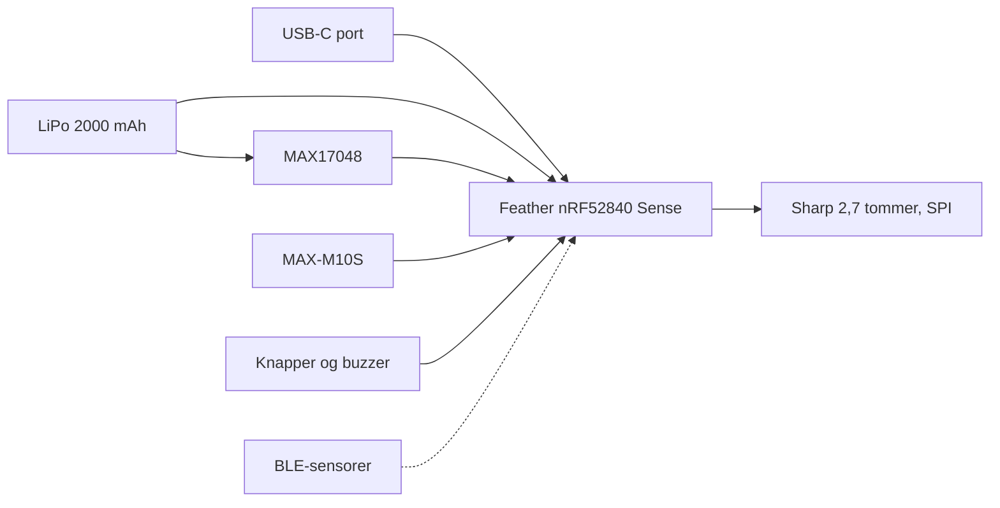

# Hardware

Anbefalingen her er den, der blev låst 29. oktober 2026. En ældre, billigere XIAO-liste står til sidst som alternativ. Priser og links ligger i [bom.md](bom.md). Strøm ligger i [power-budget.md](power-budget.md).

## Anbefalet prototype

| Del | Valg | Hvorfor |
| --- | --- | --- |
| Dev-board | Adafruit Feather nRF52840 Sense | nRF52840, LiPo-lader, 2 MB QSPI, IMU og BMP280. Officielt Zephyr-board. |
| Display | Adafruit Sharp Memory LCD 2,7" 400×240 (LS027B7DH01) | Læsbart i sol, hurtig opdatering, meget lavt forbrug. |
| GNSS | SparkFun MAX-M10S (Qwiic) | u-blox M10, fire systemer, lavt forbrug. Kræver ekstern antenne. |
| Batteri | LiPo 3,7 V 2000 mAh, JST-PH, oplyst som LP803860, 62 × 38,5 × 8,5 mm | Ligger bag displayet. Beskyttelseskreds. |
| Brændstofmåler | Adafruit MAX17048 (STEMMA QT) | Procent over I²C, omkring 23 µA. |
| Lagring | Den indbyggede 2 MB QSPI | microSD kun hvis det bliver for lidt. |
| Kabinet | PETG eller ASA, Garmin quarter-turn, O-ring | Se [../enclosure/README.md](../enclosure/README.md). |

Kort sagt: byg den første prototype på Feather Sense, Sharp-displayet og MAX-M10S. Det der batter på driftstiden er GPS-indstillingerne, ikke displayet.

## System

MAX17048 sidder over batteriet og rapporterer til Featheren over I²C. Feather Sense har allerede LSM6DS3TR-C, LIS3MDL og BMP280, så der skal ikke et ekstra IMU- eller barometer-modul med i den første ordre.

Feather Sense har micro-USB. USB-C-hullet i kabinettet går til et lille Adafruit USB-C-breakout, som loddes til USB-benene. Det er med vilje, så kabinettet ikke låses til micro-USB.

## Dev-board

| Board | Fordele | Ulemper | Pris 29. okt. 2026 |
| --- | --- | --- | --- |
| Feather nRF52840 Sense (anbefalet) | 21 GPIO, lader, 2 MB QSPI, IMU og barometer, Zephyr og Arduino | Micro-USB. Sensorerne trækker lidt i hvile | 336 kr, Kiwi |
| Feather nRF52840 Express | Samme kort uden sensorerne | Barometer og IMU skal tilføjes | 215 kr, Kiwi |
| Seeed XIAO nRF52840 | Lille, USB-C, lader, 2 MB QSPI, lav hvilestrøm | 11 GPIO. For få til display, GNSS og fire knapper uden at det bliver trangt | 89 kr, Kiwi |
| Nordic nRF52840 DK | Indbygget J-Link, strømmålepunkter, referencen for nRF Connect SDK | Stort, ingen lader, kun til bordet | Ikke tjekket |

Mål på Feather Sense, fra Adafruit: 50,80 × 22,86 × 7,2 mm uden ben. Fire monteringshuller, 2,54 mm fra hjørnerne, boret 2,54 mm. Zephyr-boardet hedder `adafruit_feather_nrf52840/nrf52840/sense`. Det står uddybet i [../firmware/README.md](../firmware/README.md).

Arduino med Adafruits nRF52-core er den hurtigste måde at se liv i display og GPS. Coren bruger SoftDevice S140, som er kun BLE, så ANT+ kan ikke komme på senere uden at skifte stak. Derfor er produktionssporet Zephyr fra starten. Arduino kan stadig bruges til en aften på breadboardet, hvis det får noget til at virke før værktøjskæden er på plads.

## Display

Sharp Memory LCD 2,7" mod et 2,9" e-paper med delvis opdatering:

| | Sharp 2,7" | E-paper 2,9" |
| --- | --- | --- |
| Opløsning | 400×240, monokrom | 296×128, sort/hvid eller grå |
| I sol | God, reflekterende | Meget god, højere kontrast |
| Opdatering | Hurtig, uden ghosting. Tal hvert sekund er fint | Omkring 0,3–0,6 s, ghosting, og et fuldt blink indimellem |
| Strøm ved 1 Hz | Meget lav | Højere. Selve opdateringen koster |
| Kulde | Uændret i normalt cykelvejr | Bliver langsommere |
| Verificeret pris | 496 kr, Opencircuit | 261 kr for Adafruit 2,9" gråtone FeatherWing, Opencircuit |

Aktivt område på LS027B7DH01 er 58,8 × 35,3 mm, punkt-afstand 0,147 mm. Framebufferen er 13,5 KB. Det er uproblematisk på nRF52840 med 256 KB RAM.

Adafruit-breakoutet måler 63,50 × 55,88 mm (Eagle-omridset). Der er et lille hak i den ene langside, og et 1×9-header langs den modsatte kant. Fire 2,5 mm monteringshuller sidder 2,54 mm fra omridsets hjørner, med 58,42 × 50,80 mm imellem. Glasset sidder på forsiden. Vinduets præcise placering i forhold til printet er et gæt i CAD-modellen og skal rettes, når modulet er målt. Der er ingen baggrundsbelysning. Til mørke skal der et par LED'er på senere. Kontrasten er lavere end e-paper (grå bund).

## GNSS

| Modul | Systemer | Strøm | Pris 29. okt. 2026 |
| --- | --- | --- | --- |
| u-blox MAX-M10S, SparkFun (anbefalet) | GPS, Galileo, GLONASS, BeiDou | Under 25 mW ved kontinuerlig sporing ifølge producenten. Strømspare-tilstande findes. SparkFun oplyser ca. 6–25 mA | 506 kr, Opencircuit. 280 kr hos Antratek, udsolgt den dag |
| Quectel L76K | GPS, BeiDou, GLONASS, QZSS | Højere end M10. Slå det aktuelle datablad op | 107 kr, Kiwi (modul) eller 117 kr (L76K til XIAO) |

SparkFun-printet er 38,10 × 30,48 mm (1,50 × 1,20 tommer). SMA-stikket rager yderligere 6,1 mm ud, så indbygningen skal regne med 44,2 × 30,5 mm. Der er ikke en chip-antenne på printet. Fase 1 skal have en separat GNSS-antenne, typisk en lille keramisk patch med kort kabel til SMA, placeret mod himlen. Kabinettets top-zone har en 25 × 25 mm lomme som pladsholder. Vælg antennen før kabinettet låses.

Power-LED'en på SparkFun-boardet kan kobles fra med en jumper. Det er værd at gøre, før der måles strøm.

MAX-M10S koster mere end L76K, men GNSS er den største post i strømbudgettet, så forskellen kan ses på driftstiden. Med L76K i stedet falder kernedelene til ca. 1.166 kr.

I²C-adressen på u-blox-moduler er 0x42, indtil den ændres. SparkFun-boardet har Qwiic. Feather Sense har ikke Qwiic, så der skal et STEMMA QT-kabel med løse hanben med.

## Batteri og fuel gauge

Butikkens mål for det valgte 2000 mAh-batteri er 62 × 38,5 × 8,5 mm med JST-PH. Typenummeret på siden er LP803860. Den normale læsning af det nummer er 8,0 × 38 × 60 mm, så mål posen når den ankommer, og ret `bat_w`, `bat_h` og `bat_t` i FreeCAD-scriptet hvis den afviger.

**Mål polariteten før stikket sættes i Featheren.** Adafruit advarer om, at et JST-PH med byttet plus og minus ødelægger laderen. Rød ledning er ikke en garanti.

MAX17048 sidder på I²C (adresse 0x36 på Adafruit-boardet) og måler cellen. Den skal have batteriets ledninger forbi sig, ikke kun en signalledning. Følg Adafruits koblingsdiagram.

## Knapper, lyd og debug

Tre eller fire 6×6 mm tactile switches er nok til start, stop, omgang og side. I kabinettet sidder de bag en 0,40 mm printet membran i sidevæggen. En piezo-buzzer er til omgang og alarmer.

En Raspberry Pi Debug Probe (CMSIS-DAP) er med i fase 1, så Zephyr kan flashes og debugges over SWD. UF2 over USB virker også til de første forsøg, via board-varianten `.../sense/uf2`.

## Lagring

2 MB QSPI på Feather Sense er udgangspunktet. En time FIT med et punkt i sekundet fylder groft 100–150 KB, altså omkring 12–15 timers kørsel før filerne skal af sted. microSD giver plads, men også et hul der skal tætnes, og højere hvilestrøm. Den er valgfri. På et senere eget printkort er en 16 MB QSPI-chip et bedre kompromis end et kort.

Filen skal kunne hentes over USB eller BLE. GPX kan laves på telefonen ud fra FIT, så enheden i første omgang kun behøver at skrive FIT.

## Kabinet

Kravene som modellen er bygget efter, står i [../enclosure/README.md](../enclosure/README.md). Kort:

- PETG eller ASA. PLA bliver blødt i sol på styret.
- Låg med spor til 2 mm silikonesnor og fire rustfri M3-skruer i varmeindsatser.
- Vindue i 1 mm polycarbonat, limet i en fals.
- Knapper som membran over tactile switches, eller færdige tætte switches senere.
- USB-C med en printet prop.
- Et lille hul med plads til en åndbar membran, så barometeret kan mærke højden.
- Garmin quarter-turn som en separat del, der skrues på låget, så holderen kan printes om uden at hele kabinettet følger med.

v1-kabinettet er med vilje rummeligt (110 × 152 × ca. 28 mm plus holderen), fordi det skal rumme breakout-print og ikke et færdigt, stablet kort.

## Alternativ: Seeed XIAO

XIAO nRF52840 er det billige spor fra den tidligere liste. Det er et godt kort, og det er mindre, har USB-C og en lav hvilestrøm. Det er ikke anbefalingen, fordi 11 GPIO bliver trangt når Sharp-displayet, GNSS, fire knapper, buzzer og fuel gauge skal have ben samtidig. Sense-udgaven har mikrofon og IMU, men stadig ikke plads nok til at det er den nemme vej.

Hvis GPIO-regnestykket løses (eget kort, en I/O-expander, eller færre knapper), er XIAO en reel senere kandidat. Indtil da købes Feather Sense.

Den ældre liste, før 29. oktober-gennemgangen, havde blandt andet:

- Seeed XIAO nRF52840, RS Danmark, 112,76 kr
- Samme kort direkte fra Seeed, 9,99 USD
- XIAO nRF52840 Sense, 15,90 USD
- Feather nRF52840 Express, Kiwi, 22,99 EUR ekskl. moms

De priser er ikke genverificeret i 29. oktober-runden, undtagen hvor [bom.md](bom.md) siger det. Brug 29. oktober-tabellen til indkøb.

## Kilder

- [Feather nRF52840 Sense, pinouts](https://learn.adafruit.com/adafruit-feather-sense/pinouts)
- [Zephyr: Adafruit Feather nRF52840](https://docs.zephyrproject.org/latest/boards/adafruit/feather_nrf52840/doc/index.html)
- [Adafruit Sharp 2,7" (produkt 4694)](https://www.adafruit.com/product/4694)
- [SparkFun MAX-M10S, måltegning](https://cdn.sparkfun.com/assets/e/8/8/9/8/SparkFun_u-blox_MAX-M10S_Board_Dimensions.png)
- [ANT for nRF Connect SDK](https://developer.garmin.com/ant-program/nrf-connect-sdk/)
- [Antratek MAX-M10S (udsolgt 29. okt. 2026)](https://www.antratek.dk/gnss-receiver-breakout-max-m10s-qwiic)
- [L76K hos Kiwi](https://www.kiwi-electronics.com/en/l76k-multi-gnss-module-with-gps-bds-and-qzss-support-20602)
- [XIAO nRF52840 hos Kiwi](https://www.kiwi-electronics.com/en/seeed-studio-xiao-nrf52840-11041)
- [Feather nRF52840 Express hos Kiwi](https://www.kiwi-electronics.com/en/adafruit-feather-nrf52840-express-4259)
